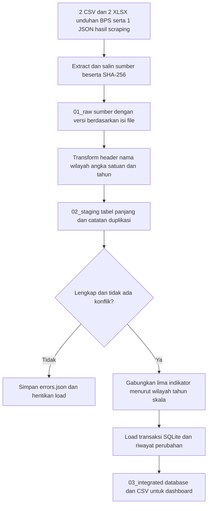

# ETL data manufaktur BPS

Pipeline ini membaca langsung lima file sumber CSV, XLSX, dan JSON dalam folder `../data_manufaktur_bps_2025`. Hasil gabungan lama tidak digunakan sebagai sumber nilai. Referensi kode wilayah hanya mengambil kode dan nama dari hasil pengambilan BPS sebelumnya.

Pipeline memakai Python 3.10 atau lebih baru dan SQLite bawaan Python. Tidak perlu memasang pandas, openpyxl, server database, atau paket tambahan. Pembaca XLSX ditujukan untuk struktur ekspor BPS yang sekarang dipakai, yaitu tabel pada lembar pertama dengan tiga kolom dan empat baris header.

## Menjalankan

Klik dua kali **jalankan_etl.bat**. Alternatif melalui PowerShell:

```powershell
cd 'C:\Mirza Personal\IAK\etl'
py -3 -B etl.py
```

Perintah tersebut sudah dijalankan pada data asli. Impor pertama memasukkan 78 baris. Impor kedua memasukkan 0 baris baru, memperbarui 0 baris, dan mempertahankan 78 baris. Data sumber tidak diubah.

## Alur pemrosesan



Tiga lapisan di atas merupakan rancangan penyimpanan ETL proyek ini. Istilah dan definisi “tiga level data” dalam materi dosen masih perlu dicocokkan. Replikasi, deduplikasi, transformasi, dan sinkronisasi dijelaskan sebagai proses tersendiri di `PENJELASAN_ETL.md`.

## Struktur folder

```text
etl/
  etl.py
  test_etl.py
  jalankan_etl.bat
  config/
    sources.json
    wilayah.json
  data/
    01_raw/<id indikator>/<sha256>.<format>
    02_staging/<id proses>/
      normalized.csv
      joined.csv
      duplicates.json
      errors.json
      warnings.json
      source_manifest.json
    03_integrated/
      manufaktur.sqlite
      exports/
        manufaktur_provinsi_2025.csv
        manufaktur_nasional_2025.csv
        indikator_dashboard_2025.csv
  logs/
    <id proses>.json
    latest.json
    hasil_pengujian.txt
    verifikasi_database.json
```

File raw yang isinya sama tidak disalin berulang. Setiap eksekusi tetap mendapat folder staging dan log baru yang kecil. Versi sumber yang berbeda disimpan dengan checksum berbeda agar revisinya dapat ditelusuri.

## Aturan transformasi dan pemeriksaan

- Empat baris header ekspor BPS dibaca sebagai metadata, bukan data provinsi.
- Tahun wajib 2025. Label Mikro/Kecil dan satuan sumber harus sesuai konfigurasi.
- Nama wilayah disamakan kapitalisasi, spasi, serta tanda bacanya, lalu dicocokkan dengan referensi kode BPS. Nama yang tidak dikenal ditolak, bukan ditebak.
- Angka disimpan sebagai integer dalam satuan sumber. Nilai uang tetap dalam juta rupiah. Nol valid dipertahankan; nilai kosong atau tidak tersedia ditolak.
- Struktur dua kolom skala diubah menjadi satu baris per `indikator + kode wilayah + tahun + skala`.
- Duplikat yang memiliki kunci dan nilai sama disatukan, dengan bukti baris asal. Nilai berbeda pada kunci sama dianggap konflik dan menghentikan load.
- Setiap indikator harus memiliki 38 provinsi dan Indonesia, masing-masing Mikro dan Kecil. Kekurangan data menggagalkan load agar penggabungan tidak membuang provinsi secara diam-diam.
- Kunci tabel akhir adalah `kode_wilayah_bps + tahun + skala`.

## Database untuk dashboard

| Objek SQLite | Isi |
| --- | --- |
| dim_wilayah | Kode, nama, dan penanda total nasional |
| fact_manufaktur | Lima indikator, 78 baris, kunci unik wilayah-tahun-skala |
| etl_runs | Riwayat proses yang berhasil dan manifest sumber |
| etl_changes | Riwayat INSERT/UPDATE serta nilai sebelum dan sesudah |
| vw_provinsi | 76 baris provinsi, tanpa total Indonesia |
| vw_nasional | 2 baris total Indonesia sesuai angka BPS |
| vw_indikator_dashboard | Data provinsi dan empat indikator perbandingan |

Kegagalan proses dicatat di file log. Jika validasi gagal, tabel fakta tidak diperbarui. Load dilakukan dalam satu transaksi; kesalahan saat menulis fakta membatalkan transaksi tersebut. Jika kesalahan terjadi saat ekspor setelah transaksi berhasil, log mencatat `load_committed: true`, sehingga status database tetap jelas.

Indikator dashboard yang tersedia:

1. Output per tenaga kerja, dalam juta rupiah per orang.
2. Output per usaha, dalam juta rupiah per usaha.
3. Tenaga kerja per usaha.
4. Rasio input terhadap output, dalam persen.

Penyebut nol menghasilkan SQL NULL, bukan nol palsu. Selisih output dan input tidak diberi label laba bersih. Pengeluaran untuk seluruh tenaga kerja juga tidak langsung diartikan sebagai rata-rata gaji pekerja dibayar.

Contoh kueri:

```sql
SELECT provinsi, skala, nilai_output_juta_rupiah,
       output_per_tenaga_kerja_juta_rupiah
FROM vw_indikator_dashboard
ORDER BY output_per_tenaga_kerja_juta_rupiah DESC;

SELECT * FROM etl_runs ORDER BY started_at DESC;
SELECT * FROM etl_changes WHERE action = 'UPDATE';
```

## Pembaruan data dan sinkronisasi

Untuk revisi tahun 2025, ganti file masukan yang sesuai di folder sumber dengan file revisi yang memiliki struktur sama, lalu jalankan ulang pipeline. Sistem mengambil snapshot baru, memvalidasi, membandingkan nilai, memperbarui baris yang berubah, dan mencatat nilai sebelumnya. Metadata URL/metode pengambilan dapat diperbarui di `config/sources.json` jika sumber berubah.

Pipeline ini menyinkronkan file lokal ke database saat dijalankan. Pengambilan revisi otomatis dari situs BPS dan penjadwalan belum dibuat. Perubahan cakupan provinsi, tahun, atau struktur tabel perlu penyesuaian konfigurasi dan pemeriksaan; jangan mengubah tahun pada file hanya untuk melewati validasi.

Sumber JSON nilai input adalah hasil scraping tabel HTML publik BPS, bukan respons WebAPI berautentikasi. Informasi ini dipertahankan pada manifest setiap proses.

## Pengujian

```powershell
py -3 -B -m unittest discover -v
```

Sepuluh pengujian integrasi mencakup pembacaan tiga format, impor ulang, revisi satu nilai, duplikat identik, duplikat konflik, nilai kosong, provinsi hilang, tahun salah, nilai nol, dan pembagian dengan nol. Data uji memakai salinan sementara sehingga tidak mengubah sumber asli atau database utama.

Bukti pengujian ada di `logs/hasil_pengujian.txt`. Pemeriksaan database dan pencocokan seluruh baris terhadap data acuan pengambilan sebelumnya ada di `logs/verifikasi_database.json`.

## Catatan agregasi

Total Indonesia dipisahkan dari detail provinsi supaya tidak dihitung dua kali. Ada selisih kecil antara penjumlahan provinsi dan angka nasional pada beberapa indikator. Catatan BPS menyebut pembulatan digit terakhir; pipeline mencatat selisih sebagai peringatan dan mempertahankan kedua angka sumber. Selisih yang besar tetap perlu diperiksa, karena peringatan ini bukan pembuktian bahwa semua selisih disebabkan pembulatan.

Tahap ini menyelesaikan pipeline ETL lokal dan keluaran database. Website, login, dan visualisasi interaktif masih merupakan pekerjaan berikutnya.
